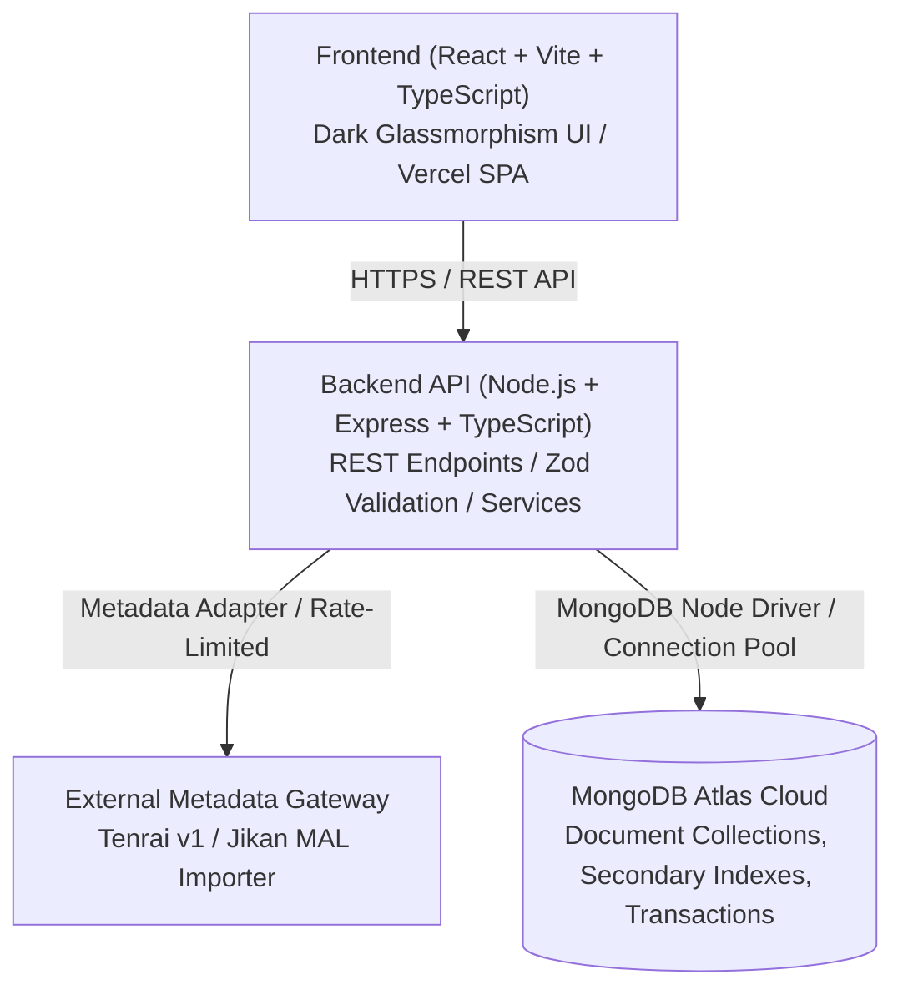

# AnimeManager — System Architecture

**Edition:** MongoDB Edition  
**Version:** 2.0  
**Status:** Certified Architecture & Production-Ready  

---

## 1. System Overview

AnimeManager is a private-first personal catalog and progress tracker for anime, manga, and manhwa. The application strictly distinguishes between **Bookmarks** (watch/read tracking status, episode/chapter progress, rating, and notes) and **My List** (user-defined thematic collections and folders).



### Key Architectural Tenets
1. **Separation of Concerns:** Business logic lives in backend services; UI components handle presentation and user interactions; the database enforces unique constraints, indexes, and referential consistency.
2. **Private-First Security:** The application is scoped to authorized library owners. Access to catalog mutations and private user data is enforced via standard Bearer JWT tokens (HS256) and strict tenant isolation (`ownerId`).
3. **Resilient Metadata Import:** External metadata providers can be rate-limited or temporarily unavailable. All imported data passes through an editable preview draft before persistence, and manual title entry remains fully functional independently.
4. **Document Data Modeling:** Titles embed rich metadata (aliases, genres, tags, external IDs) as natural subdocuments, while collections and bookmarks maintain atomic references with multi-document ACID transaction support.
5. **Data Ownership & Portability:** All metadata, custom collections, and tracking progress can be exported at any time via authenticated JSON and CSV export endpoints.

---

## 2. Monorepo Repository Structure

The project uses npm workspaces to coordinate three modular packages:

```text
AnimeManager/
├── apps/
│   ├── web/                         # Frontend Application (React 18, Vite 5, TS)
│   │   ├── src/
│   │   │   ├── app/                 # Root app component, router, providers
│   │   │   ├── components/
│   │   │   │   ├── layout/          # Shell, Navigation, Header, MobileNav
│   │   │   │   └── ui/              # Glassmorphism buttons, cards, dialogs, inputs
│   │   │   ├── lib/                 # API client, TanStack Query client, auth context
│   │   │   ├── pages/               # Dashboard, Titles, Detail, Collections, Bookmarks, Import, Settings
│   │   │   └── styles/              # Design tokens, glassmorphism CSS, animations
│   │   ├── index.html
│   │   ├── package.json
│   │   └── vite.config.ts
│   │
│   └── api/                         # Backend REST API (Node.js, Express, TS)
│       ├── src/
│       │   ├── app.ts               # Express application configuration & middleware
│       │   ├── server.ts            # HTTP server entry point & graceful shutdown
│       │   ├── config/              # Zod environment variable validation
│       │   ├── controllers/         # Request/response handlers
│       │   ├── middleware/          # Auth, error handling, rate limiting, request ID
│       │   ├── repositories/        # MongoDB data-access layer (mongo.ts, titles, bookmarks, collections)
│       │   ├── routes/              # Express route definitions
│       │   └── services/            # Core business logic & external metadata adapters
│       ├── package.json
│       └── tsconfig.json
│
├── packages/
│   └── shared/                      # Shared types, constants, and Zod schemas
│       ├── src/
│       │   ├── constants/           # Status enums, media types
│       │   ├── schemas/             # Zod input validation schemas
│       │   └── types/               # TypeScript domain interfaces
│       ├── package.json
│       └── tsconfig.json
│
├── api/                             # Vercel Serverless Function entry point
│   └── index.js
│
├── docs/                            # Project documentation & technical guides
├── scripts/                         # Development & operational utilities
├── package.json                     # Monorepo root configuration & scripts
└── vercel.json                      # Vercel routing & build configuration
```

---

## 3. MongoDB Data Architecture

The data-access layer utilizes the official MongoDB Node.js driver (`mongodb >= 6.0`) with connection pooling and replica set transaction support.

### Collections & Schema Design

#### 1. `titles` Collection
Stores canonical metadata for anime, manga, and manhwa titles. Embedded arrays model nested 1:N relations without join overhead:
- `_id`: String UUID (matches domain identifier).
- `ownerId`: String UUID (library owner).
- `mediaType`: `'anime' | 'manga' | 'manhwa'`.
- `englishTitle`, `originalTitle`, `synopsis`, `background`.
- `coverUrl`: Direct HTTP(S) image URL.
- `releaseYear`, `publicationStatus`, `startDate`, `endDate`, `episodeCount`, `chapterCount`.
- `sourceScore`, `sourceRank`, `sourcePopularity`.
- `aliases`: Array of `{ id, alias, languageCode, aliasType }`.
- `genres`: Array of `{ id, name, slug }`.
- `tags`: Array of `{ id, name, slug }`.
- `externalSources`: Array of `{ id, provider, externalId, sourceUrl }`.
- `createdAt`, `updatedAt`: Timestamps.

**Indexes:**
- `{ ownerId: 1, englishTitle: 1 }`
- `{ ownerId: 1, mediaType: 1 }`
- Text index: `{ englishTitle: 'text', originalTitle: 'text', 'aliases.alias': 'text' }`

#### 2. `bookmarks` Collection
Maintains user reading/watching progress and personal ratings. Independent of collection membership:
- `_id`: String UUID.
- `ownerId`: String UUID.
- `titleId`: String UUID referencing `titles._id`.
- `status`: `'plan_to_consume' | 'consuming' | 'completed' | 'on_hold' | 'dropped'`.
- `progress`: Number (current episode/chapter).
- `progressUnit`: `'episode' | 'chapter'`.
- `progressTotal`: Number (total episodes/chapters or null).
- `priority`: Number (1–5).
- `personalRating`: Number (1.0–10.0 or null).
- `notes`: String (personal thoughts).
- `startedAt`, `completedAt`, `createdAt`, `updatedAt`: Timestamps.

**Indexes:**
- `{ ownerId: 1, titleId: 1 }` (Unique constraint: 1 bookmark per title per owner)
- `{ ownerId: 1, status: 1 }`

#### 3. `collections` Collection
User-created thematic lists and folders ("My List"):
- `_id`: String UUID.
- `ownerId`: String UUID.
- `name`: User-facing name (e.g. "Favorites").
- `normalizedName`: Lowercase trimmed string (e.g. "favorites").
- `description`, `icon`, `color`, `sortMode`.
- `titleCount`: Cached count of items.
- `items`: Array of embedded objects: `{ titleId, position, addedAt }`.
- `createdAt`, `updatedAt`: Timestamps.

**Indexes:**
- `{ ownerId: 1, normalizedName: 1 }` (Unique constraint: prevents duplicate collection names per owner)
- `{ ownerId: 1, 'items.titleId': 1 }`

---

## 4. Multi-Document ACID Transactions

Complex workflows that mutate multiple documents use the `withOptionalTransaction` abstraction in `mongo.ts`. When running against MongoDB Atlas replica sets:
1. **Jikan/Tenrai Import Commit:** Atomically inserts the title document, initializes the corresponding bookmark, and adds the title to selected collections in a single transactional unit. If an error occurs, zero partial records are committed.
2. **Title Deletion Cascade:** Deleting a title atomically removes its associated bookmark and prunes the `titleId` from all collection `items` arrays while updating `titleCount`.

---

## 5. Authentication & Security Architecture

1. **Decoupled JWT Verification:** Handled via Express middleware using `jsonwebtoken` and `JWT_SECRET` (HS256).
2. **Required Claims:** Tokens must provide a valid UUID `sub` (representing the owner), an expiration timestamp (`exp`), and standard role claims. Anonymous roles (`anon`) and unsigned tokens (`algorithm: none`) are strictly rejected.
3. **Development Session Guard:** In development mode (`ENABLE_DEV_AUTH=true`), the API provides fresh sessions for the seeded local owner. In production (`NODE_ENV=production`), `ENABLE_DEV_AUTH=true` triggers an immediate fatal startup error.
4. **Rate Limiting & DoS Protection:** Sliding-window in-memory rate limiting on external import endpoints (`RateLimit-*` and `Retry-After` headers) and 1MB payload limits (`PAYLOAD_TOO_LARGE`).
