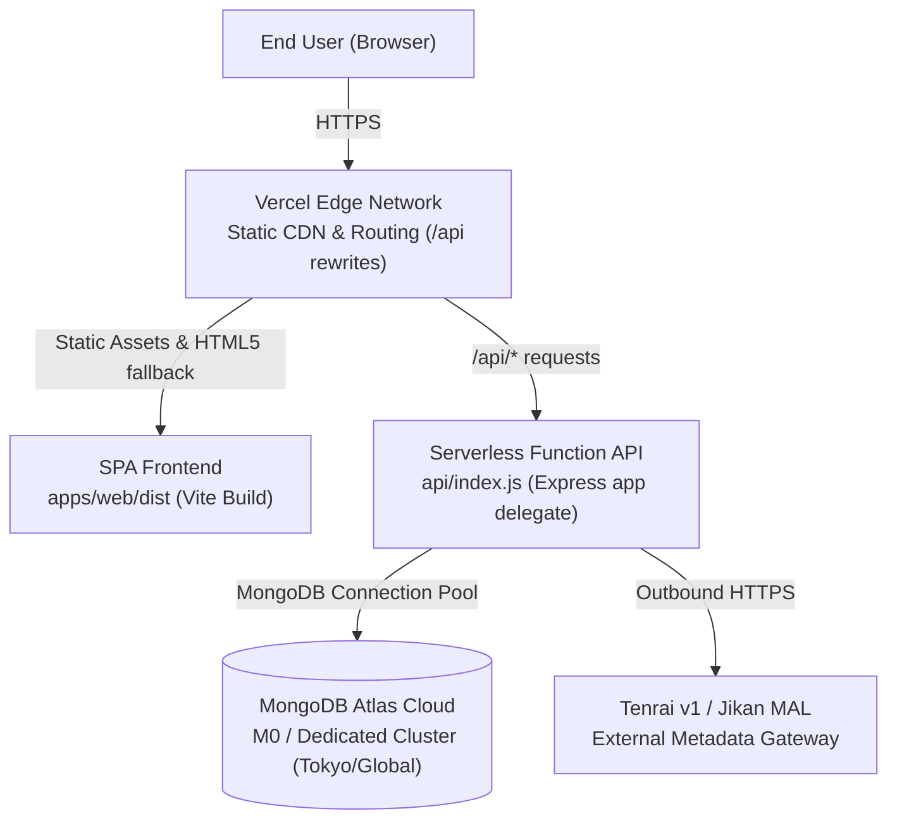

# AnimeManager — Deployment & Production Guide

**Edition:** MongoDB Edition  
**Version:** 2.0  
**Status:** Certified Deployment-Ready  

---

## 1. Deployment Architecture Overview

AnimeManager is architected for deployment as a unified monorepo on **Vercel** backed by **MongoDB Atlas** for document persistence:



---

## 2. Production Environment Variables

Configure the following variables in your hosting provider's project settings (e.g. Vercel Project Settings > Environment Variables).

### Backend Runtime Variables (Vercel Functions / Server)
| Variable Name | Required | Example Placeholder | Purpose |
| :--- | :---: | :--- | :--- |
| `NODE_ENV` | Yes | `production` | Activates production security guards. |
| `MONGODB_URI` | Yes | `mongodb+srv://<user>:<pass>@<cluster>.mongodb.net/?retryWrites=true&w=majority` | Hosted MongoDB Atlas connection string (must not point to localhost). |
| `MONGODB_DB_NAME` | Yes | `animemanager_production` | Target production database. **MUST NOT** be `animemanager`, `animemanager_test`, or contain `test`. |
| `JWT_SECRET` | Yes | `[GENERATE_HIGH_ENTROPY_RANDOM_SECRET]` | Secret for verifying Bearer tokens (min 16 chars). |
| `CORS_ORIGIN` | Yes | `https://your-domain.vercel.app` | Allowed frontend production origin (must not be `*` or localhost). |
| `ENABLE_DEV_AUTH` | No | *(Must remain unset or false)* | Rejected automatically in production if true. |
| `METADATA_API_BASE_URL` | No | `https://api.tenrai.org/v1` | External metadata provider. |

### Frontend Build Variables (Vite Bundle)
| Variable Name | Required | Example Placeholder | Purpose |
| :--- | :---: | :--- | :--- |
| `VITE_API_BASE_URL` | No | `/api/v1` | Relative API path for unified Vercel deployment. |
| `VITE_APP_TITLE` | No | `AnimeManager` | Application title display. |

---

## 3. Serverless Connection Pooling

In a serverless environment (such as AWS Lambda or Vercel Serverless Functions), stateless function instances can spin up concurrently. AnimeManager's MongoDB layer detects serverless environments (`process.env.VERCEL`) and automatically optimizes connection pooling:
- `maxPoolSize`: Capped at `3` per container (prevents exhausting Atlas connection limits during spikes).
- `minPoolSize`: `0` (permits idle sockets to close).
- `maxIdleTimeMS`: `10000` (10s idle socket reclamation).
- `clientInstance` reuse: Active clients are cached globally across function invocations within the same container.

---

## 4. Production Security & Fail-Safe Guards

The backend includes startup assertions in `config/index.ts` that will immediately throw a fatal error on boot if insecure configurations are detected in production:
1. **Rejection of Development Auth:** If `NODE_ENV === 'production'` and `ENABLE_DEV_AUTH === true`, the API refuses to start.
2. **Rejection of Default Secrets:** If `JWT_SECRET` matches the development fallback placeholder string, the API refuses to start.
3. **Rejection of Localhost DB:** If `NODE_ENV === 'production'` and `MONGODB_URI` points to `localhost` or `127.0.0.1`, the API refuses to start.
4. **Mandatory Explicit Production DB:** If `MONGODB_DB_NAME` is omitted, empty, or set to the development database `animemanager` or any test database, the API refuses to start.
5. **Mandatory Explicit CORS Origin:** If `CORS_ORIGIN` is omitted, set to wildcard `*`, contains localhost/127.0.0.1, or is malformed, the API refuses to start.

---

## 5. One-Time Production Index Initialization

Serverless cold-start invocations intentionally omit index initialization to keep request latency low. When deploying to a newly created production database, you must run the explicit index provisioning script before routing live user traffic:

```bash
# 1. Preview planned index specifications (safe dry run, zero database operations):
npm run init:indexes -- --dry-run

# 2. Provision canonical indexes and uniqueness constraints on the production database:
npm run init:indexes -- --database animemanager_production --confirm --uri "$PROD_MONGODB_URI"
```

Safety guards:
- The script refuses to run without an explicit `--database` argument.
- The script refuses unconditionally to run against `animemanager`, `dev`, or `development` under any circumstance.
- The script refuses to run against test databases unless the explicit `--allow-test-target` override is provided.
- The script rejects `--allow-test-target` if targeted at production database names.
- The script requires explicit `--confirm` authorization.
- The script is idempotent; it creates missing indexes and never drops collections, documents, or data.

---

## 6. Public Health Checks & Diagnostic Redaction

Public health endpoints provide operational signals without disclosing internal infrastructure:
- `GET /api/v1/health/liveness`: Returns HTTP 200 with process liveness and uptime.
- `GET /api/v1/health`: Checks database connectivity and schema completeness. Returns HTTP 200 when healthy, or HTTP 503 when degraded.
- **Privacy Assurance:** Public responses never disclose MongoDB hostnames, cluster URLs, database names, or exception details.

---

## 7. Production Authentication Bootstrap

AnimeManager Version 1 uses a single-owner JWT authentication contract:
1. **Development Routes Disabled:** `/api/v1/auth/dev-session` and `/api/v1/auth/dev-token` return HTTP 404 in production mode.
2. **Token Generation:** The operator generates a personal session token using the production `JWT_SECRET`:
   ```bash
   JWT_SECRET="$PROD_JWT_SECRET" node scripts/generate-session-token.js --raw | pbcopy
   ```
3. **Browser Storage:** Paste the generated JWT into the web interface under **Settings > Authentication Token** to authenticate the session.

---

## 8. Vercel Deployment Configuration

The repository includes a root `vercel.json` configured for unified full-stack hosting:

```json
{
  "version": 2,
  "builds": [
    { "src": "api/index.js", "use": "@vercel/node" },
    { "src": "package.json", "use": "@vercel/static-build" }
  ],
  "routes": [
    { "src": "/api/(.*)", "dest": "/api/index.js" },
    { "handle": "filesystem" },
    { "src": "/(.*)", "dest": "/index.html" }
  ]
}
```

- **API Entry Point:** `api/index.js` imports the Express application from `apps/api/dist/app.js` and forwards incoming serverless requests.
- **Frontend Output:** Static assets from `apps/web/dist` are served by Vercel Edge with HTML5 client-side routing fallback.
